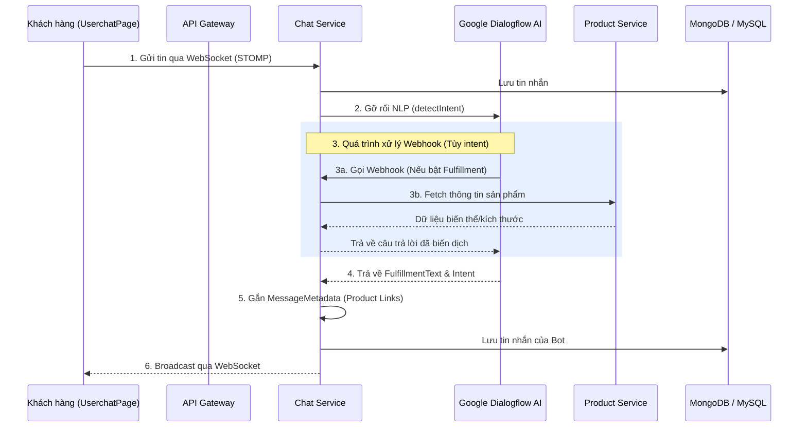

# Luồng Hoạt Động Của Hệ Thống Chatbot AI (Tích hợp Dialogflow & Microservices)

Tài liệu này giải thích chi tiết luồng hoạt động của tính năng Chatbot từ lúc người dùng gửi tin nhắn trên giao diện đến khi nhận được phản hồi chính xác (ví dụ: tư vấn sản phẩm kèm nút "Xem ngay").

---

## 1. Kiến trúc Tổng quan (Architecture Diagram)

Hệ thống hoạt động dựa trên luồng Real-time (WebSockets) kết hợp với kiến trúc Microservices và AI (Dialogflow).

---

## 2. Diễn giải Chi tiết Từng Bước (Step-by-step Flow)

### Bước 1: Khách hàng gửi tin nhắn từ Frontend (`UserchatPage.tsx`)
- Khi người dùng nhập "Tôi tìm nệm 1m6" và nhấn gửi.
- Giao diện React sẽ đóng gói nội dung và đẩy đi qua giao thức **WebSocket (SockJS + STOMP)** với destination là `/app/chat.send`.
- (Giao diện áp dụng cơ chế *Optimistic UI* - tin nhắn của khách lập tức nổi lên màu xanh ngay cả khi mạng đang tải).

### Bước 2: Nhận diện & Định tuyến (Discovery Server & API Gateway)
- Toàn bộ kết nối được đi qua cổng bảo vệ **API Gateway**.
- Service **Discovery Server (Eureka)** làm nhiệm vụ định tuyến, phân luồng kết nối WebSocket này vào đúng cổng của **`chat-service`**.

### Bước 3: Xử lý tại Chat Service & Gọi Dialogflow (`DialogflowService.java`)
- `MessageController` trong `chat-service` tiếp nhận tin nhắn từ WebSocket. 
- Nó kiểm tra xem đoạn chat này có đang ở trạng thái `BOT_ONLY` (Tự động Chatbot) không.
- Nếu đúng, `DialogflowService` sẽ gọi hàm `detectIntent` và gửi kèm chữ "Tôi tìm nệm 1m6" lên **Google Dialogflow ES**.

### Bước 4: Dialogflow phân tích ngôn ngữ tự nhiên (`intents/` & `entities/`)
Tại Google Dialogflow (hoặc theo cấu hình trong folder `mattress-agent`):
- **Entities (Thực thể):** Bot dựa vào từ điển `size_entries_vi.json` để trích xuất được kích thước `1m6` thành tham số `size: 160x200`.
- **Intents (Ý định):** Bot so khớp câu nói với `search_product_usersays_vi.json`, từ đó hiểu rằng ý định của user là `search_product` (tìm kiếm sản phẩm).
- Vì intent này được cấu hình **Enable Webhook Call for this Intent**, thay vì trả lời theo một câu cố định trong Dialogflow, nó lập tức call một HTTP Request ngược lại backend của chúng ta.

### Bước 5: Chat Service Webhook kết nối Product Service (`DialogflowWebhookController.java`)
- Request từ Dialogflow trỏ vào endpoint `/api/dialogflow/webhook` của **`chat-service`**.
- Webhook phân tách các Entities (`size`, `brand`, v.v.).
- Backend tự động gọi nội bộ sang **`product-service`** nhờ vào `RestTemplateConfig.java` được cấu hình `@LoadBalanced` để fetch các sản phẩm thỏa điều kiện (VD: Nệm 160x200).
- Sau khi có list danh sách sản phẩm, Controller này format text trả về cho Dialogflow (Ví dụ: "Mình tìm thấy X sản phẩm có kích thước...").

### Bước 6: Hoàn thiện dữ liệu `productLinks`
- Từ Webhook, Dialogflow trả kết quả cuối cùng (Fulfillment Text) về cho hàm `detectIntent` của `DialogflowService`.
- Backend của ta lập tức xây dựng đối tượng `MessageMetadata`, lấy các product data trích xuất được để tạo mảng **`productLinks`** (Bao gồm tên sản phẩm, giá bán, và `slug`/`id` để điều hướng).
- Tin nhắn của Bot được lưu xuống MongoDB.

### Bước 7: Trả kết quả về Frontend màn hình User & Admin
- **`chat-service`** gửi bản tin chứa Fulfillment Text và `MessageMetadata` lên kênh `/topic/conversation.{id}` qua WebSocket.
- Cả `UserchatPage.tsx` và `AdminChatPage.tsx` đều đang lắng nghe (subscribe) kênh này. Ngay lập tức UI được render lại:
  - Hiển thị văn bản (Text bubble màu tím cho Bot).
  - Khối mã kiểm tra: Nếu `msg.metadata.productLinks` có tồn tại, React sẽ render vòng lặp `.map()` để sinh ra các **thẻ chứa link ẩn** (Các nút "Xem ngay").
  - Do ta đã tích hợp thư viện `react-router-dom`, thẻ `<Link to={...}>` sẽ được đính kèm để người dùng bấm vào sẽ chuyển mượt màn hình sang `/product/:id` mà không cần reload trang.

---

> [!TIP]
> **Tóm gọn lại:** User nhắn tin -> WebSocket dồn về Backend -> Đẩy cho AI đọc hiểu -> AI bảo Backend tự lấy Data từ DB -> Backend lấy Data trả ngược về cho AI ráp thành câu văn -> Backend gom văn bản và Links trả về Frontend qua WebSocket -> Frontend vẽ ra nút chuyển hướng siêu mượt bằng thẻ `Link`.
